  

 

)
)

---

### `01 // THESIS`

> I build models, training pipelines, and software systems from first principles—preferring custom derivations over black-box wrappers. By day, I research neural architectures, heuristic search, and next-generation AI. By night, I treat GPU memory bottlenecks and stubborn loss curves like boss fights.

---

### `02 // ACTIVE BUILDS`

| System | Domain | Architecture & Status |
| :--- | :--- | :--- |
| **[TownSphere](https://townsphere.org)** | Privacy-First Public Opinion | Anonymous polling & demographic sentiment analytics platform engineered with a minimalist monochrome UI. Built on **Flutter**, **FastAPI**, and **PostgreSQL**. `● IN PRODUCTION` |
| **Developmental LM** | Cognitive AI / Language Models | Experimental language model inspired by child cognitive acquisition: zero initial weight initialization, byte-level patching, VQ-syntax bottlenecks, and continuous surprise-driven learning from single-sentence inputs. `● R&D` |

---

### `03 // RESEARCH LOGS & PUBLICATIONS`

Click any dossier below to inspect the methodology:

<code>[2025]</code> <b>Multimodal AI for Indian Sign Language via Federated Learning</b> — <i>IEEE NKCon 2025</i>

 

* Integrated speech recognition, Spatio-Temporal Graph Convolutional Networks (ST-GCN), and LSTMs for bidirectional audio/video ISL translation with decentralized weight aggregation.

<code>[2025]</code> <b>A U-Net and Transformer Pipeline for Multilingual Image Translation</b> — <i>arXiv Preprint</i>

 

* Built an end-to-end visual translation pipeline combining U-Net text region detection, OCR, and a custom Transformer trained from scratch across 5 languages.

<code>[2025]</code> <b>Generalizable Blood Cell Detection via Unified Dataset & Faster R-CNN</b> — <i>arXiv Preprint</i>

 

* Unified four hematological datasets into an aligned tensor pipeline using PyTorch ResNet-50 FPN for cross-dataset peripheral blood cell localization.

---

